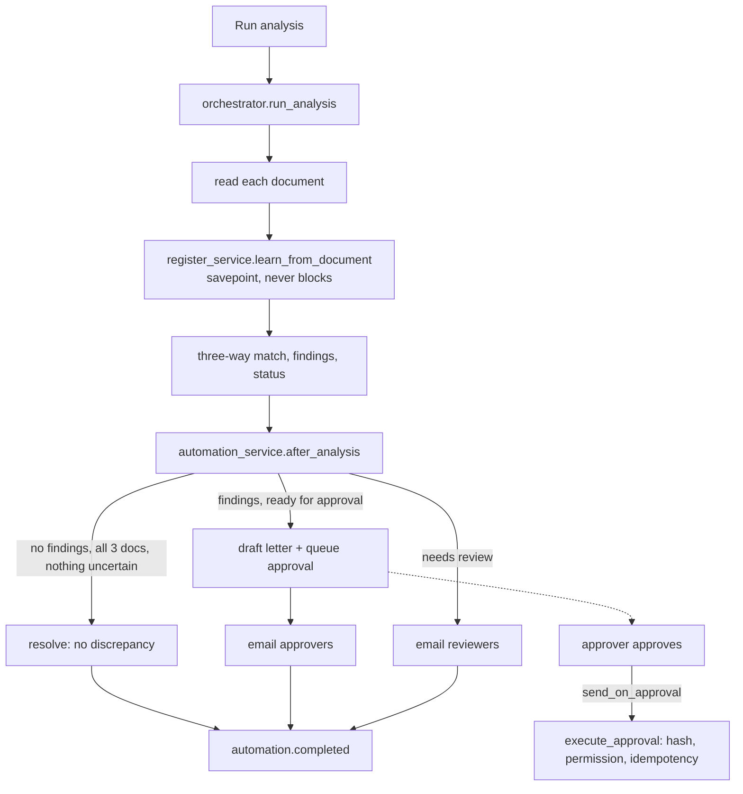

# Design: Autopilot

## Flow

## Components
- `services/register_service.py`: `learn_from_document(db, document, doc)`. Normalizes names (`normalize_text`) and PO numbers (`normalize_reference`), adds or fills, links the case, audits `register.*`. Called by the orchestrator through `_learn`, inside `db.begin_nested()`.
- `services/automation_service.py`: `draft_letter`, `queue_for_approval` (shared with the approvals routes), `notify_people`, `after_analysis`. Runs in `cases._run_analysis_job` after the orchestrator, because letter drafting may call a model and the orchestrator makes no model calls except OCR.
- `services/policy_service.py`: `Automation` flags stored as nullable booleans on `workspace_policies` (NULL = on), `get_automation`, `save_automation`.
- `routes/approvals.py`: `decide_approval` calls `execute_approval` after an approval when the switch allows; an `ApiError` rolls back and leaves the letter approved.
- `routes/events.py`: streams `register.*` and `automation.completed`; safe payload keys gain `actions`, `name`, `po_number`.
- OCR prompt and `StructuredDocument` gain `supplier_email`, `supplier_phone`, `supplier_address`, described as the seller's details, never the buyer's.

## Frontend
- `lib/analysis-stages.ts`: pure `buildStages(events)` -> five stages with state and detail.
- `components/cases/detail/analysis-stages.tsx`: 44px circles. Waiting shows the step number; active shows the stage icon with a quarter arc turning (900ms linear, compositor-only `transform`); done pops in with a tick (220ms `--ease-out`, from `scale(0.9)`); failed shows a cross. Connectors fill with `scaleX`/`scaleY` over 300ms. Reduced motion stops the arc; global rules cut durations.
- The case page freezes the stream's replay time per run, so status changes mid-run don't restart it, and the stream ends on `automation.completed` or `analysis.failed`.
- `components/settings/automation-card.tsx`: one switch per flag for admins, on/off badges for others.

## Security notes
- A supplier email read from a document only fills an empty register field. The approver sees the exact recipient in the approval before anything is sent, and the payload hash locks it.
- Notifications go only to workspace members, include no document content, and are rate limited per case.
- Register matching is always scoped by `workspace_id`.

## Testing
`backend/tests/test_automation.py`: clean case closes; discrepancy queues a letter and emails approvers only; switches off; register learning (suppliers, POs, numbers, search, workspace isolation, PO file copy); no overwrite of typed fields; send on approval; reject sends nothing. `frontend/tests/analysis-stages.test.ts` covers stage order, details, clean close and failure.
