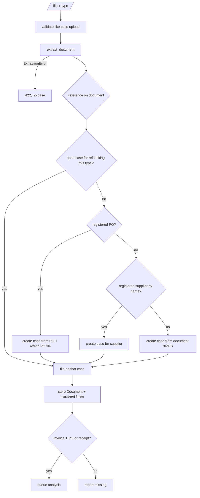

# Design: Smart intake

## Overview
A new endpoint `POST /api/v1/workspaces/{workspace_id}/intake` (multipart: `file`, `document_type`) runs synchronously: validate, extract, route, store, optionally queue analysis. Routing is deterministic code; the only model call is OCR inside `extract_document`, whose numbers are re-checked as today.



## Components
- `services/intake_service.py`: pure routing helpers (`reference_of`, `find_open_case`, `find_registered_po`, `find_supplier`) plus `route_document` that returns an `IntakeDecision`.
- `agents/orchestrator.record_extraction`: persists an already-extracted `StructuredDocument` (fields, `ExtractionRun`, status `extracted`, audit), reused by intake.
- `api/routes/intake.py`: handler; reuses `_detect_and_validate`, `registry.attach_po_file_to_case`, `cases._run_analysis_job`, `case_service.next_case_number`.

## Data
No new tables. Cases created by intake set `supplier_id` / `purchase_order_id` when matched. Audit event `intake.routed` with `{document_type, matched_by, reference, created_case}`.

## Response
```json
{ "case_id": "...", "case_number": "OW-2026-0007", "created": true,
  "matched_by": "purchase_order", "document_type": "invoice",
  "reference": "PO-2231", "supplier_name": "Northstar Office Supplies",
  "missing": ["delivery_receipt"], "analysis_started": true, "message": "..." }
```

## Error handling
- Validation errors reuse upload codes (`EMPTY_FILE`, `FILE_TOO_LARGE`, `UNSUPPORTED_FILE_TYPE`, `INVALID_DOCUMENT_TYPE`).
- Unreadable documents: `422 UNREADABLE_DOCUMENT`, nothing created.

## Testing strategy
- API tests: routes to a registered PO and attaches its file; second document joins the same case and starts analysis; falls back to supplier match and to document-only; never crosses workspaces; contributors allowed, non-members 404; unreadable files create nothing.
- Property test: for any reference formatting (case, spaces, dashes), a document routes to the same registered PO.
