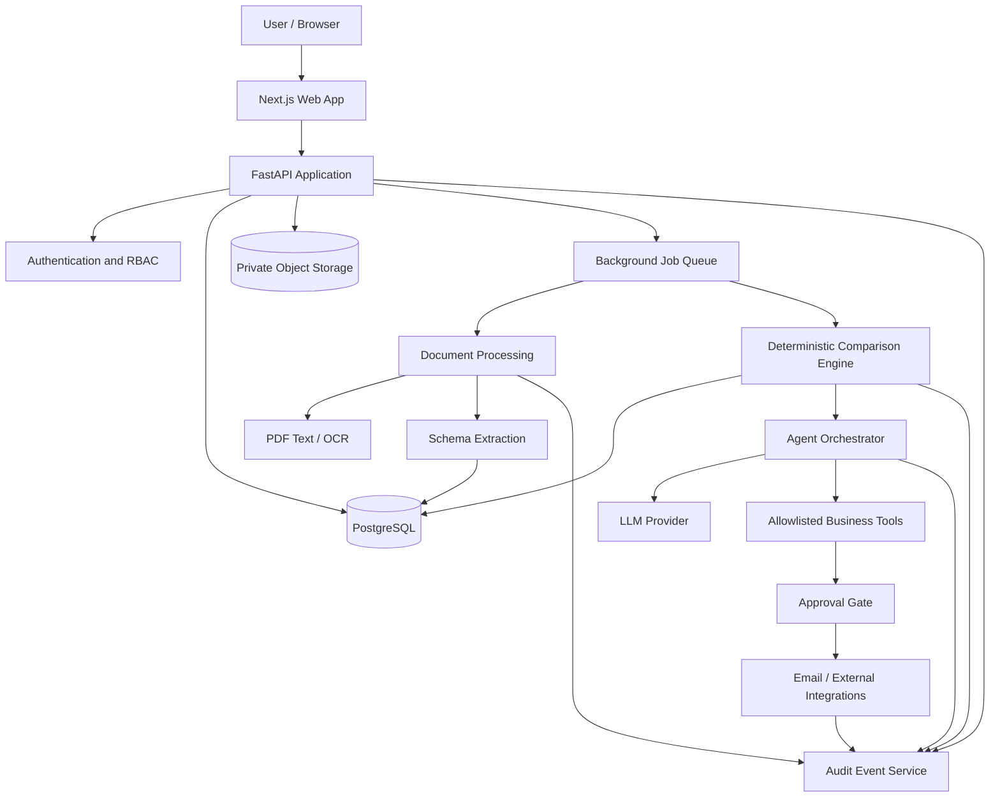
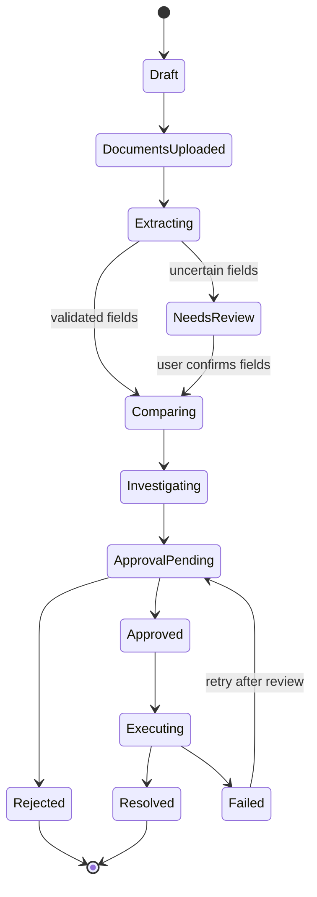

# Technical Architecture
## OpsWarden — MVP System Design

**Version:** 1.0  
**Architecture style:** Modular monolith with asynchronous document-processing jobs and bounded agent orchestration.

---

## 1. Architecture goals

- Deliver a working, understandable MVP quickly.
- Keep business rules deterministic and testable.
- Separate LLM reasoning from authorization and side effects.
- Maintain tenant isolation.
- Make document processing asynchronous and observable.
- Preserve evidence lineage from source document to finding.
- Allow integrations to be added without redesigning the core.

## 2. High-level architecture



## 3. Recommended implementation shape

Start with a modular monolith:
- One frontend application.
- One FastAPI backend with clear modules.
- One PostgreSQL database.
- Private object storage.
- One background worker process.
- One agent orchestration module.
- External integrations behind provider interfaces.

Do not split into microservices during the hackathon unless a measured constraint requires it.

## 4. Backend modules

Suggested structure:

```text
backend/
  app/
    main.py
    core/
      config.py
      security.py
      permissions.py
      logging.py
    api/
      deps.py
      routes/
        auth.py
        workspaces.py
        cases.py
        documents.py
        findings.py
        approvals.py
        activity.py
    models/
      workspace.py
      membership.py
      case.py
      document.py
      extraction.py
      finding.py
      approval.py
      audit_event.py
    schemas/
      case.py
      document.py
      extraction.py
      finding.py
      approval.py
    services/
      case_service.py
      document_service.py
      extraction_service.py
      comparison_service.py
      investigation_service.py
      recommendation_service.py
      approval_service.py
      audit_service.py
    agents/
      orchestrator.py
      intake_agent.py
      investigation_agent.py
      resolution_agent.py
      prompts/
    integrations/
      email/
        base.py
        provider.py
      storage/
        base.py
        provider.py
    workers/
      tasks.py
    tests/
      unit/
      integration/
      property/
```

## 5. Frontend structure

```text
frontend/
  app/
    (auth)/
      login/
    (workspace)/
      overview/
      investigations/
      approvals/
      documents/
      activity/
      settings/
  components/
    layout/
    dashboard/
    cases/
    documents/
    evidence/
    approvals/
    activity/
    ui/
  lib/
    api-client.ts
    auth.ts
    schemas.ts
    formatters.ts
  hooks/
  types/
```

## 6. Data model

All business records should be scoped to a workspace. Enforce access in backend services and database policies where supported.

### `workspaces`
- `id` UUID primary key
- `name`
- `created_at`

### `workspace_members`
- `id`
- `workspace_id`
- `user_id`
- `role` (`admin`, `reviewer`, `contributor`)
- `created_at`

### `cases`
- `id`
- `workspace_id`
- `case_number`
- `title`
- `supplier_name`
- `supplier_reference`
- `currency`
- `status`
- `owner_user_id`
- `created_by`
- `created_at`
- `updated_at`
- `resolved_at` nullable

### `documents`
- `id`
- `workspace_id`
- `case_id`
- `document_type` (`purchase_order`, `invoice`, `delivery_receipt`)
- `storage_key`
- `original_filename`
- `mime_type`
- `size_bytes`
- `sha256`
- `processing_status`
- `uploaded_by`
- `created_at`

### `extraction_runs`
- `id`
- `workspace_id`
- `case_id`
- `document_id`
- `schema_version`
- `status`
- `provider`
- `model`
- `started_at`
- `completed_at`
- `error_code` nullable

### `extracted_fields`
- `id`
- `workspace_id`
- `document_id`
- `field_path`
- `value_json`
- `confidence` nullable
- `source_page` nullable
- `source_text` nullable
- `review_status`
- `corrected_by` nullable
- `corrected_at` nullable

### `findings`
- `id`
- `workspace_id`
- `case_id`
- `finding_type`
- `severity`
- `title`
- `description`
- `expected_value_json`
- `observed_value_json`
- `impact_amount` nullable
- `currency` nullable
- `status` (`open`, `confirmed`, `dismissed`, `needs_review`)
- `rule_id`
- `created_at`

### `finding_evidence`
- `id`
- `workspace_id`
- `finding_id`
- `document_id`
- `field_path`
- `page_number` nullable
- `snippet` nullable

### `recommendations`
- `id`
- `workspace_id`
- `case_id`
- `finding_id` nullable
- `recommendation_type`
- `summary`
- `rationale`
- `payload_json`
- `status`
- `created_at`

### `approvals`
- `id`
- `workspace_id`
- `case_id`
- `recommendation_id`
- `action_type`
- `action_payload_json`
- `status` (`pending`, `approved`, `rejected`, `executed`, `failed`, `expired`)
- `requested_by`
- `reviewed_by` nullable
- `reviewed_at` nullable
- `executed_at` nullable
- `idempotency_key`

### `audit_events`
- `id`
- `workspace_id`
- `case_id` nullable
- `actor_type` (`user`, `system`, `agent`, `integration`)
- `actor_id` nullable
- `event_type`
- `event_payload_json`
- `correlation_id`
- `created_at`

Use database migrations. Add foreign keys, indexes, unique constraints, and tenant-scoped query patterns. Consider row-level security as a defence-in-depth layer, not a replacement for backend authorization.

## 7. Document processing pipeline

1. Receive upload request after authenticating the user.
2. Authorize access to the target workspace and case.
3. Validate size, MIME type, extension, and file signature.
4. Compute a content hash.
5. Store file in a private bucket using a non-guessable object key.
6. Create a document row and queue a processing job.
7. Extract embedded PDF text where possible.
8. Use OCR for scanned pages or image documents.
9. Normalize extracted text and page references.
10. Call structured extraction with a strict schema.
11. Validate output and numeric formats.
12. Persist extraction run and fields.
13. Mark uncertain values for human review.
14. Emit audit events and update case status.

Never execute or render uploaded files as trusted active content. Consider malware scanning and PDF resource limits before production use.

## 8. Comparison engine

The comparison engine should be ordinary application code.

### Matching strategy

1. Match by SKU or supplier item code when available.
2. Match by normalized reference.
3. Use description similarity only to propose candidate matches.
4. Route ambiguous matches to manual review.

### Example rules

- `INVOICE_QTY_GT_RECEIVED`: invoice quantity exceeds received quantity.
- `RECEIVED_QTY_LT_ORDERED`: recorded delivery is below ordered quantity.
- `UNIT_PRICE_MISMATCH`: invoice unit price differs from PO beyond tolerance.
- `DUPLICATE_INVOICE`: invoice number already exists for the same supplier/workspace.
- `TOTAL_MISMATCH`: computed line totals or totals do not reconcile.
- `SUPPLIER_MISMATCH`: supplier identity differs across documents.

Use `Decimal` or an equivalent decimal arithmetic type for money. Make currency and rounding rules explicit. Do not compare floating-point money values.

Every rule should produce:
- Rule ID.
- Finding type.
- Severity from configured policy.
- Compared values.
- Calculation / comparison explanation.
- Evidence references.
- Human-review requirement.

## 9. Agent orchestration

### Design

Use a bounded workflow graph or explicit state machine. The LLM should assist with document normalization, ambiguous description matching, investigation summaries, and recommendations. It should not be responsible for access control, arithmetic, or final action authorization.

### Suggested flow



### Agent input/output contracts

- Inputs must be scoped to one authorized case.
- Outputs must conform to versioned JSON schemas.
- Every factual statement in a summary must map to a finding or evidence item.
- Tool calls must use a server-side allowlist.
- Limit maximum steps, tokens, runtime, and retries.
- Record model/provider metadata and errors.
- Do not expose hidden reasoning; return concise explanations and evidence.

## 10. Approval and integration pattern

Use a two-phase pattern:

1. **Prepare:** create an immutable proposed action with recipient, subject, body, case ID, and evidence references.
2. **Approve:** an authorized user reviews the exact action payload.
3. **Execute:** backend re-checks permission, approval status, payload hash, and idempotency key before calling the integration.
4. **Record:** persist provider result and audit event.

If the payload changes after approval, invalidate the approval and request a new one.

## 11. API and background processing

See `API-CONTRACTS.md` for endpoint details.

Long-running work should be queued. API returns a job or case status rather than holding the request open through OCR and agent execution. Frontend can poll case status or subscribe to server-sent events if implemented.

## 12. Deployment topology

Recommended hackathon deployment:
- Frontend: managed Next.js hosting.
- API: container or Python application hosting.
- Worker: separate process using the same backend image.
- PostgreSQL: managed database.
- Storage: private object storage.
- Redis: managed Redis if a queue is used.
- Secrets: deployment platform secret manager.

Use separate development and production environments. Do not commit `.env` files or credentials.

## 13. Reliability and observability

- Correlation ID per case-processing run.
- Structured logs with workspace and case identifiers, but no document contents or secrets.
- Retry only transient failures.
- Idempotent processing jobs.
- Dead-letter or failed-job visibility.
- Processing stage timestamps.
- Provider timeout and rate-limit handling.
- Health and readiness endpoints.

## 14. Architecture decisions

| Decision | Reason |
|---|---|
| Modular monolith first | Lower operational complexity for a hackathon |
| Deterministic comparison | Reliable, testable financial and quantity checks |
| Human approval | Prevent unsafe external side effects |
| Private object storage | Protect business documents |
| Async processing | OCR and LLM calls can take time |
| Evidence references | Make findings verifiable |
| Explicit state machine | Prevent uncontrolled agent workflows |
