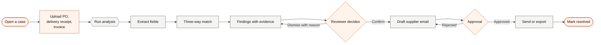
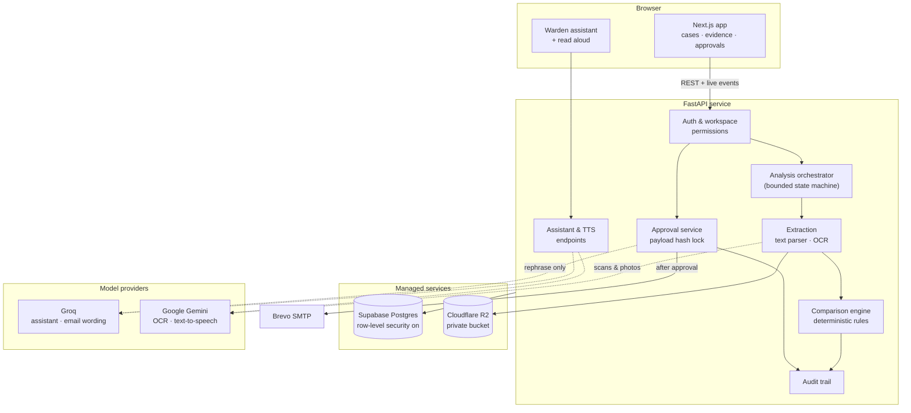
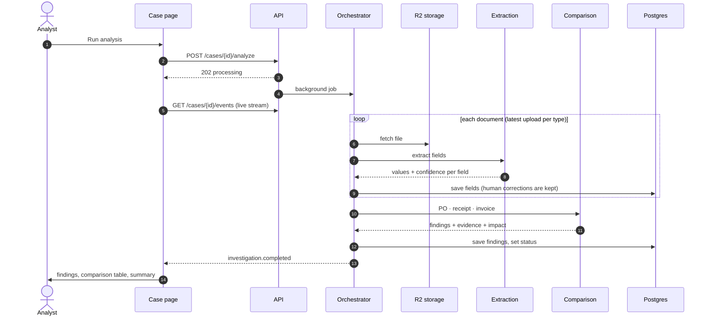
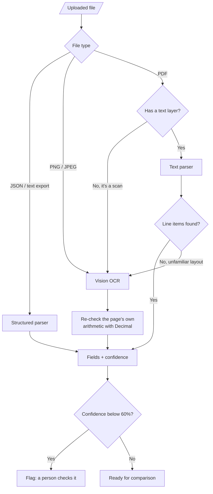
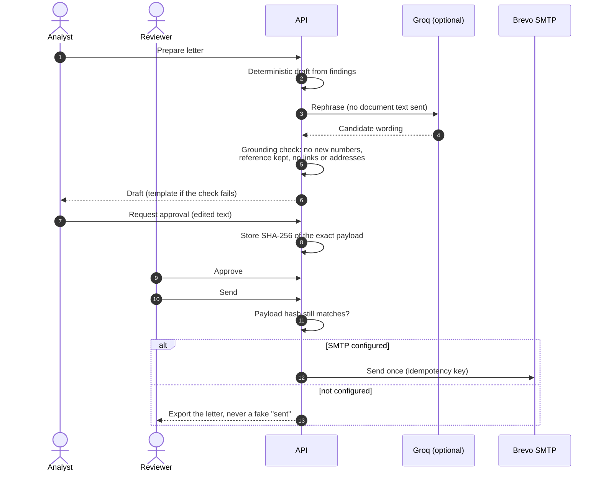
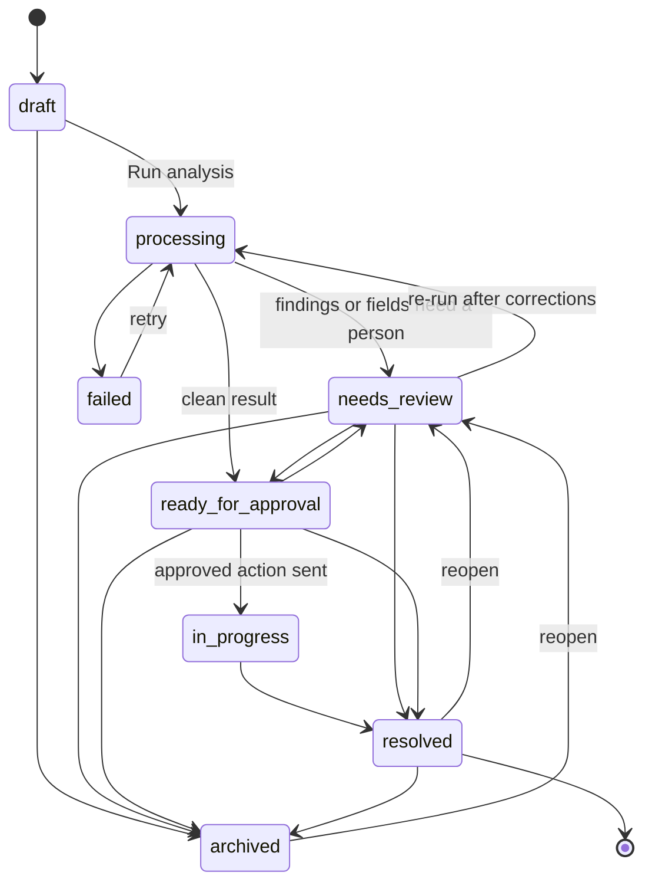
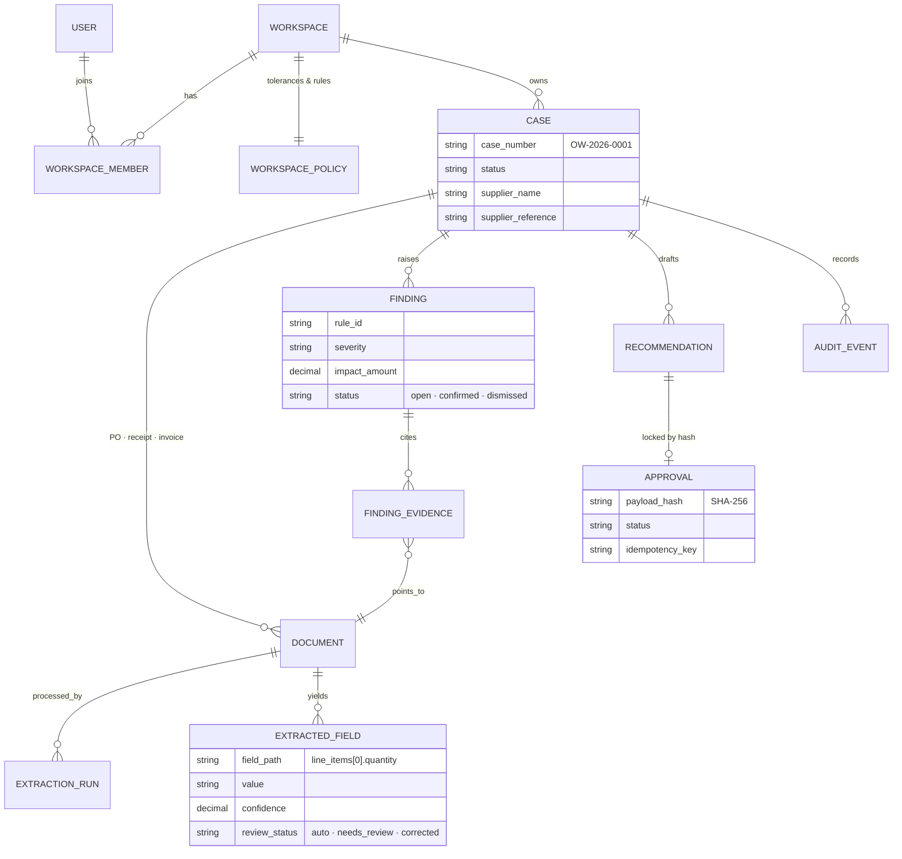
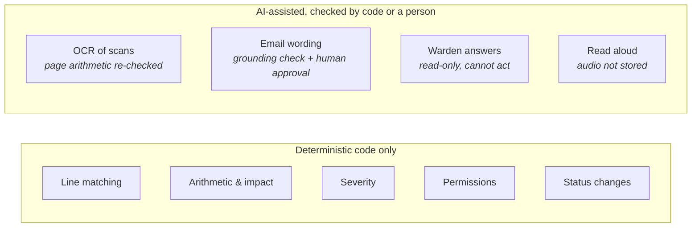
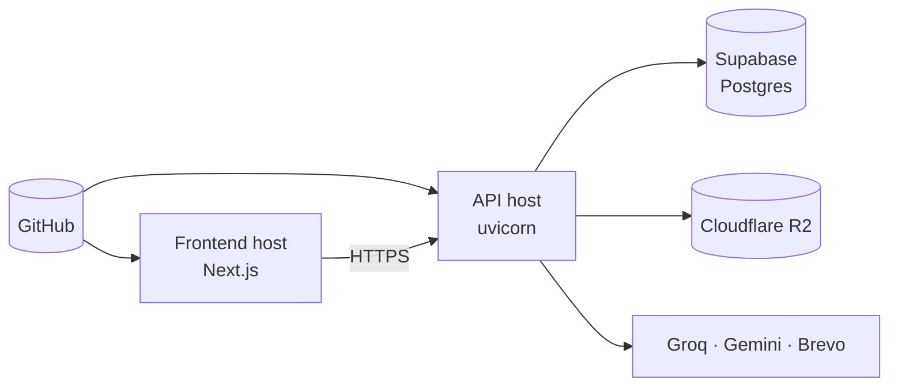

<div align="center">

# OpsWarden

**From supplier paperwork to a defensible decision.**

OpsWarden reconciles a purchase order, a delivery receipt and a supplier invoice,
shows every discrepancy with the exact document field it came from,
and drafts the supplier email for a person to approve.


</div>

---

## Why OpsWarden

Three-way matching is the oldest control in procurement, and it is still mostly done by eye. Someone opens three PDFs, compares quantities line by line, does the arithmetic and writes an email. Mistakes in either direction cost money: overpaying a supplier, or accusing one wrongly.

OpsWarden does the comparison deterministically and leaves the judgement to people.

| Principle | What it means in practice |
|---|---|
| **Evidence first** | Every finding names the rule, the expected and observed values, the impact, and the document field it came from. |
| **Exact arithmetic** | Money and quantities use `Decimal` end to end. Currencies are never added together. |
| **AI where it helps, never as the authority** | Models read scans, answer questions and polish wording. They never decide a finding, a severity or an amount. |
| **People approve side effects** | Nothing reaches a supplier until an authorised reviewer approves the exact text. |
| **Everything is on the record** | Uploads, corrections, decisions, approvals and sends are written to an audit trail. |

---

## How it works



Orange steps are taken by a person. Grey steps are done by OpsWarden.

---

## System architecture



The API is a modular monolith. Each request is checked for workspace membership and role on the server; the frontend's permission checks only decide which buttons to show.

---

## The analysis pipeline

When someone presses **Run analysis**, the API answers immediately (`202 Accepted`) and runs the job in the background. Progress streams to the case page as events.



### Extraction: which reader handles a file



The OCR model only transcribes what is printed. Afterwards each line (`quantity × unit price = line total`) and the totals (`lines = subtotal`, `subtotal + tax = total`) are re-computed. A number that doesn't reconcile on its own page is marked for review instead of quietly becoming a finding.

---

## The comparison rules

Lines are matched by SKU first and by description similarity second. Weak matches are flagged rather than trusted. Every rule is plain code with explicit severity.

| Area | Rule | Severity | Raised when |
|---|---|---|---|
| Completeness | `MISSING_DOCUMENT` | high / medium | The invoice, PO or receipt is missing |
| Identity | `SUPPLIER_MISMATCH` | high | The supplier name differs across documents |
| | `PO_REFERENCE_MISSING` | medium | The invoice doesn't cite a PO |
| | `PO_REFERENCE_MISMATCH` | medium | The invoice cites a different PO |
| | `CURRENCY_MISMATCH` | high | PO and invoice use different currencies |
| | `DUPLICATE_INVOICE` | high | The invoice number already exists for this supplier |
| Quantities | `INVOICE_QTY_GT_RECEIVED` | high | Billed for more than arrived |
| | `RECEIVED_QTY_LT_ORDERED` | medium | Short delivery |
| | `INVOICE_QTY_NE_ORDERED` | medium | Billed quantity differs from the order |
| Prices | `UNIT_PRICE_MISMATCH` | high | Invoice price differs from the PO beyond tolerance |
| Arithmetic | `LINE_TOTAL_MISMATCH` | medium | `qty × price ≠ line total` |
| | `TOTAL_MISMATCH` | high | Lines and tax don't add up to the invoice total |
| Matching | `AMBIGUOUS_MATCH` | low | A line could only be matched loosely |

Price and quantity tolerances are workspace policy, set by an admin in **Settings**.

**Example.** The PO orders 50 units at 12.00, the receipt records 40 and the invoice bills 50. OpsWarden raises `INVOICE_QTY_GT_RECEIVED` with an impact of **(50 − 40) × 12.00 = 120.00 USD**, plus a short-delivery finding, and cites the quantity field on each document.

---

## Human approval

A supplier email is built only from validated findings. A person edits it, and a reviewer approves that exact text.



Changing a single character after approval breaks the hash, so the edit needs a new approval. Contributors can prepare letters but cannot approve them.

---

## Case lifecycle

Status changes go through one controlled transition map. Clients can't set an arbitrary status.



---

## Data model



Every row carries a `workspace_id`, and every query is scoped by it.

---

## Where AI is used, and where it isn't



**Warden**, the in-app assistant, answers from a permission-scoped snapshot of the workspace: case register, open findings, waiting approvals, and the current case if you're on one. File contents are never sent to it. Case numbers in its replies become links, and those links are built by the server from real records, so the model can't invent one.

If a model is unavailable, everything still works. Drafts fall back to templates and Warden falls back to built-in help.

---

## Roles

| Capability | Admin | Reviewer | Contributor |
|---|:---:|:---:|:---:|
| Create cases, upload documents, correct fields | ● | ● | ● |
| Confirm or dismiss findings | ● | ● | — |
| Draft letters and request approval | ● | ● | — |
| Approve and send supplier emails | ● | ●¹ | — |
| Workspace activity log, settings, team | ● | — | — |

¹ An admin can restrict approvals to admins in **Settings**.

---

## Getting started

**Prerequisites:** Python 3.12+, Node.js 20+.

### 1. Backend

```bash
cd backend
python -m venv .venv
# Windows: .venv\Scripts\activate    macOS/Linux: source .venv/bin/activate
pip install -r requirements-dev.txt
cp .env.example .env
uvicorn app.main:app --port 8099 --reload
```

With the defaults it uses SQLite and local disk, and seeds a demo workspace with sample cases. No external services are needed.

### 2. Frontend

```bash
cd frontend
npm install
cp .env.example .env.local
npm run dev
```

Open http://localhost:3000.

### 3. Sign in

| Role | Email | Password |
|---|---|---|
| Admin | `admin@opswarden.app` | `Password123!` |
| Reviewer | `reviewer@opswarden.app` | `Password123!` |
| Contributor | `contributor@opswarden.app` | `Password123!` |

> [!WARNING]
> These are public demo credentials. On a hosted deployment, change the passwords or remove the accounts before real data goes in, and set `NEXT_PUBLIC_SHOW_DEMO_ACCOUNTS=false`.

### 4. Try the demo path

1. Open the **Northstar Office Supplies** case and press **Run analysis**.
2. Open the high-severity finding and follow its evidence link to the invoice field.
3. Press **Prepare letter**, edit it, and **Request approval**.
4. Sign in as the contributor and notice you can't approve. Then approve as the admin and send or export the letter.

---

## Configuration

Copy `backend/.env.example` and `frontend/.env.example`. Every setting is optional for local development.

| Capability | Backend variables | Without it |
|---|---|---|
| Database | `DATABASE_URL` (Supabase session pooler URL) | Local SQLite |
| Document storage | `STORAGE_BACKEND=r2`, `R2_ACCOUNT_ID`, `R2_BUCKET`, `R2_ACCESS_KEY_ID`, `R2_SECRET_ACCESS_KEY`, `R2_JURISDICTION` | Local disk |
| Assistant & email wording | `LLM_PROVIDER=groq`, `LLM_API_KEY`, `LLM_MODEL` | Built-in help and templates |
| OCR & read aloud | `GEMINI_API_KEY`, `OCR_MODEL`, `TTS_MODEL`, `TTS_VOICE` | Scans are flagged as failed; no audio |
| Email sending | `SMTP_HOST`, `SMTP_PORT`, `SMTP_USERNAME`, `SMTP_PASSWORD`, `SMTP_FROM` | Approved letters are exported |
| Sign-in | `AUTH_PROVIDER` (`local` or `supabase`), `SUPABASE_URL` | Built-in email and password |
| Security | `SECRET_KEY` (32+ random characters), `FRONTEND_ORIGIN` | Development defaults |

**Settings → Integrations** shows which of these are connected on a running server.

---

## Deploying



1. **Database.** Create the schema on Supabase. The script only adds missing tables and columns, never drops anything, and enables row-level security:
   ```bash
   python scripts/migrate.py          # read-only comparison
   python scripts/migrate.py --apply  # create what's missing
   ```
2. **Accounts.** Either seed the demo accounts (`python scripts/seed_demo_accounts.py`) or set `BOOTSTRAP_ADMIN_EMAIL` and `BOOTSTRAP_ADMIN_PASSWORD` for a first admin.
3. **API.** Set `OPSWARDEN_ENV=production` with real values for `SECRET_KEY`, `DATABASE_URL`, `FRONTEND_ORIGIN` and the R2 settings. In production the API refuses to start with a weak secret, SQLite, local disk storage, or a localhost origin.
4. **Frontend.** Set `NEXT_PUBLIC_API_URL` to the API's public URL, then `npm run build && npm run start`.
5. **Check.** Open **Settings → Integrations**, then run one case end to end.

---

## Testing

```bash
# Backend: unit, API flow, access control and property-based tests (Hypothesis)
cd backend && pytest -q

# Frontend: type safety and unit tests
cd frontend && npm run typecheck && npm test

# Live checks against running servers
python smoke_test.py          # full demo path, permissions, approvals
python scripts/smoke_ai.py    # assistant, read aloud, OCR on a scanned invoice
```

The property-based tests cover the invariants that matter most:

- Equal quantities never produce a quantity finding.
- Reordering line items doesn't change the outcome.
- A rejected approval can't execute.
- An edited payload can't reuse an old approval.
- Retrying a sent action doesn't send twice.
- A non-member can't read another workspace's case.

---

## Security at a glance

| Threat | Control |
|---|---|
| Cross-tenant access | Every query is scoped by workspace. Non-members get `404`, not `403`. |
| Forged or replayed actions | Approvals are bound to a SHA-256 of the exact payload. Sends use idempotency keys. |
| Prompt injection in documents | Document text is treated as data. Models never receive tools, and email rewrites must pass a grounding check. |
| Malicious uploads | Extension, MIME type and file signature are all checked. Keys are opaque and never derived from filenames. |
| Leaked files | The R2 bucket is private. Files are streamed only to signed-in members. |
| Direct database access | Row-level security is enabled on every table exposed by Supabase's REST API. |
| Secrets in logs | Keys travel in headers, never URLs. Audit events store metadata, never model output. |

Detailed threat model: [`OpsWarden_Documentation/SECURITY.md`](OpsWarden_Documentation/SECURITY.md).

---

## Built with Kiro

OpsWarden was developed in the Kiro IDE. The `.kiro/` directory holds the project's hooks and skills, and [`OpsWarden_Documentation/KIRO-GUIDE.md`](OpsWarden_Documentation/KIRO-GUIDE.md) describes the spec-driven workflow.

## Documentation

| Document | Contents |
|---|---|
| [PRD](OpsWarden_Documentation/PRD.md) | Users, requirements, scope, acceptance criteria |
| [Design](OpsWarden_Documentation/DESIGN.md) | UX principles, components, screens |
| [Architecture](OpsWarden_Documentation/ARCHITECTURE.md) | Components, data model, orchestration |
| [API contracts](OpsWarden_Documentation/API-CONTRACTS.md) | Endpoints, payloads, events |
| [Security](OpsWarden_Documentation/SECURITY.md) | Threat model and trust boundaries |
| [Implementation plan](OpsWarden_Documentation/IMPLEMENTATION-PLAN.md) | Milestones and definition of done |
